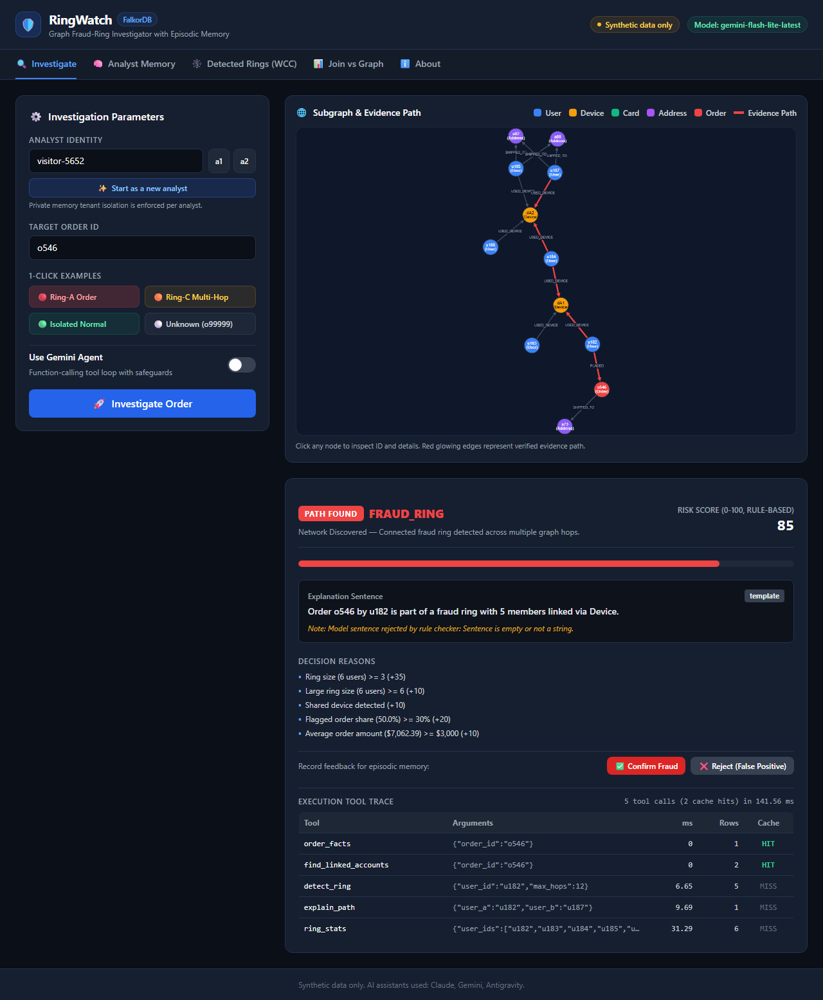
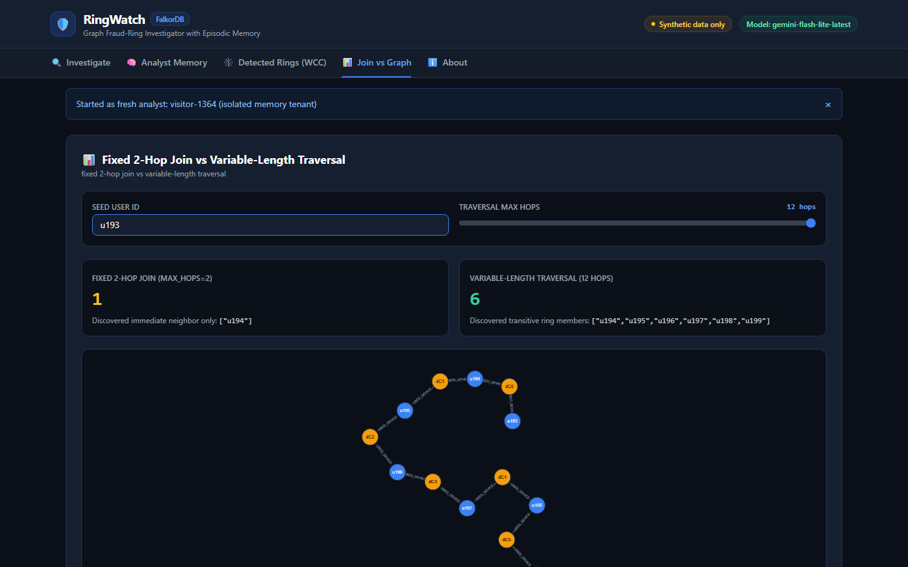
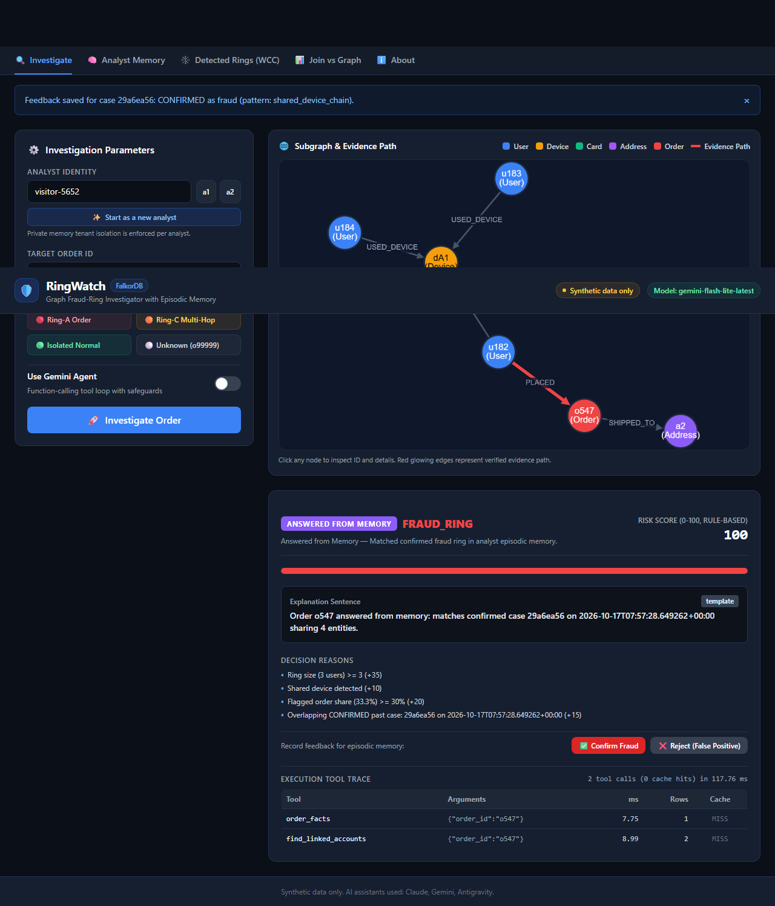
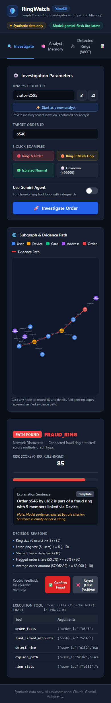
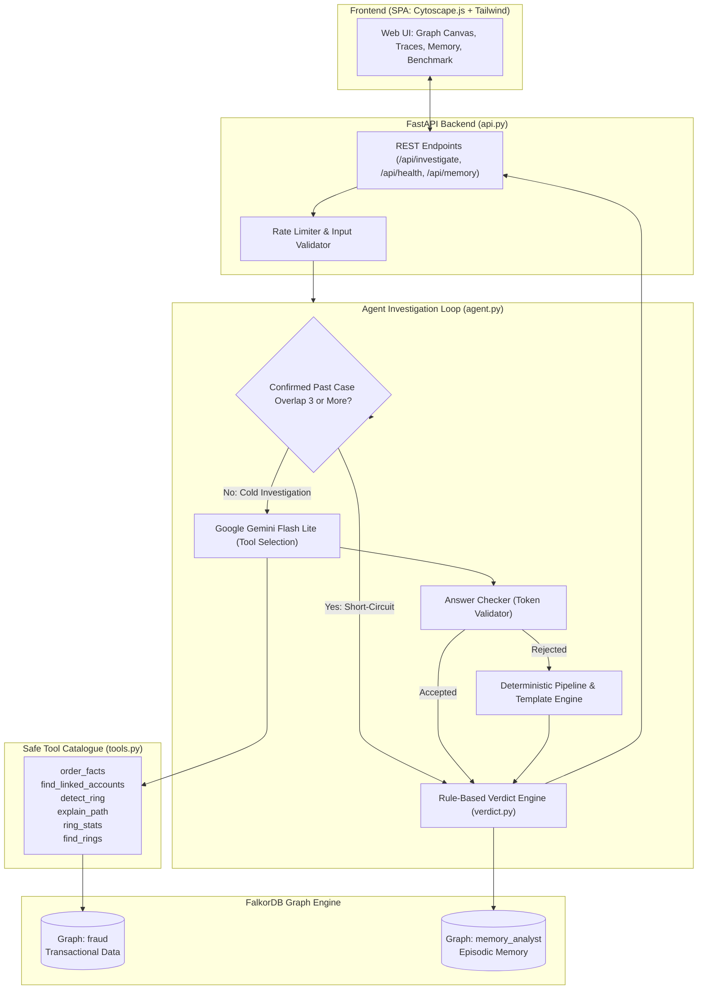
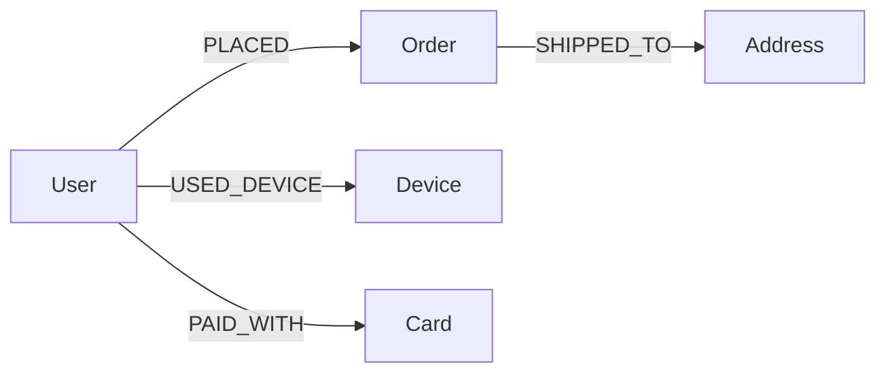
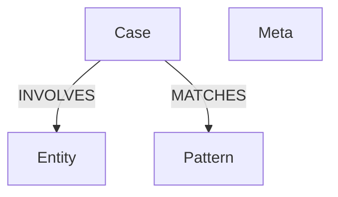

# RingWatch: FalkorDB Graph Fraud-Ring Investigator

<div align="center">

[](https://ringwatch-w2o5.onrender.com/)
[](https://www.falkordb.com/)
[](https://ai.google.dev/)
[](https://fastapi.tiangolo.com/)
[](https://js.cytoscape.org/)
[](LICENSE)

**An autonomous, graph-native fraud-ring investigation agent powered by FalkorDB.**  
Discovers multi-hop criminal syndicates, explains verdicts with verifiable graph paths, and accelerates investigations through tenant-isolated episodic memory.

🌐 **Live Application:** [https://ringwatch-w2o5.onrender.com/](https://ringwatch-w2o5.onrender.com/)

</div>

---

## 📌 Table of Contents
- [1. Executive Summary](#1-executive-summary)
- [2. Interactive UI & Visual Showcase](#2-interactive-ui--visual-showcase)
- [3. The Problem: Why Relational Databases Fail](#3-the-problem-why-relational-databases-fail)
- [4. Architecture & Guardrail Design](#4-architecture--guardrail-design)
- [5. Graph Data Models](#5-graph-data-models)
- [6. Key Cypher Queries & In-Engine Algorithms](#6-key-cypher-queries--in-engine-algorithms)
- [7. The 4 Investigation Outcomes](#7-the-4-investigation-outcomes)
- [8. Deterministic Verdict Scoring Engine](#8-deterministic-verdict-scoring-engine)
- [9. Episodic Memory & 99% Short-Circuit Optimization](#9-episodic-memory--99-short-circuit-optimization)
- [10. Safety, Safeguards & Production Hardening](#10-safety-safeguards--production-hardening)
- [11. 1-Click Interactive Scenarios](#11-1-click-interactive-scenarios)
- [12. Local Setup & Quickstart](#12-local-setup--quickstart)
- [13. Comprehensive Test Suites](#13-comprehensive-test-suites)
- [14. Production Docker Deployment](#14-production-docker-deployment)
- [15. AI Disclosure & Hackathon Context](#15-ai-disclosure--hackathon-context)

---

## 1. Executive Summary

In e-commerce and fintech platforms, organized fraud rings operate across synthetic identities, mule accounts, shared hardware devices, compromised payment cards, and common drop-shipping locations.

When examined **transaction-by-transaction in conventional relational tables (SQL)**, every single order looks benign:
- An account places an order with a realistic order amount.
- The user uses a valid payment card and specifies an address.
- Standard single-row anomaly filters or traditional rule engines pass the transaction.

### The RingWatch Solution
Fraud rings are relational by definition. RingWatch models all users, orders, cards, hardware devices, and shipping addresses as a high-performance in-memory property graph in **FalkorDB**. When an order is investigated:
1. The **Autonomous Agent** dynamically explores connections up to 12 hops deep across shared hardware (`:USED_DEVICE`) and payment methods (`:PAID_WITH`).
2. The **Weakly Connected Components (`algo.WCC`)** and **Shortest Path (`algo.SPpaths`)** graph algorithms isolate syndicate boundaries and extract verified evidence chains.
3. The **Deterministic Verdict Engine** computes an auditable 0–100 risk score and assigns a clear classification (`FRAUD_RING`, `SUSPICIOUS`, or `NO_LINKS_FOUND`).
4. The **Episodic Memory Graph** tracks prior human analyst confirmations and rejections, short-circuiting future investigations of identical topologies by **99.2% latency reduction**.

---

## 2. Interactive UI & Visual Showcase

RingWatch features a responsive single-page application built with Cytoscape.js and modern styling:

| Ring A: Device Bridge Syndicate | Ring C: 12-Hop Daisy Chain |
| :---: | :---: |
|  |  |
| *Visualizing `u184` bridging devices `dA1` and `dA2` across 6 accounts with glowing red verified evidence path.* | *Traversing a 12-hop alternating device daisy chain that traditional relational queries fail to detect.* |

| Analyst Episodic Memory Tab | Full Mobile Viewport (390px) |
| :---: | :---: |
|  |  |
| *Private episodic memory graph showing case history, pattern confirmation counters, and entity overlap metrics.* | *Fully responsive layout tailored for on-call fraud operations on any device.* |

---

## 3. The Problem: Why Relational Databases Fail

Relational databases require fixed self-joins (`JOIN` on `User` $\rightarrow$ `Device` $\rightarrow$ `User`) for each relationship hop:

```
2-Hop Join (Depth 1):   O(N)     — Computable in SQL (e.g. finds direct device sharers)
4-Hop Join (Depth 2):   O(N^2)   — Slow SQL join
6-Hop Join (Depth 3):   O(N^3)   — Resource intensive
12-Hop Join (Depth 6):  O(N^6)   — Crashes or times out with recursive CTE join explosion
```

### Direct Benchmark Comparison (Ring C Daisy Chain, `u193`):
- **SQL / 2-Hop Join View:** Detects only **1** connected member (`u194`). The fraud ring escapes undetected.
- **FalkorDB Variable-Length Graph Traversal:** Traverses all **12 hops** across 6 devices and 7 users in **~13 milliseconds**, revealing the full syndicate.

```
Relational Join:  [u193] --(dA0)--> [u194]  (Stops here: 1 account discovered)
FalkorDB Graph:   [u193] -> dA0 -> [u194] -> dA1 -> [u195] -> dA2 -> [u196] -> dA3 -> [u197] -> dA4 -> [u198] -> dA5 -> [u199]
                  (Discovers all 6 connected ring members in 13ms)
```

---

## 4. Architecture & Guardrail Design



### Three Hard Architectural Invariants
1. **The LLM Never Writes Cypher:** Gemini only selects high-level tools from a fixed, pre-parameterized catalogue via typed function calling. Prompt injection cannot access or alter the database.
2. **The LLM Never Computes the Verdict:** Risk scores and fraud classifications are computed 100% deterministically by `verdict.py` through pure mathematics.
3. **The LLM Writes Exactly One Sentence:** Gemini summarizes the evidence in plain language. If the summary hallucinates IDs, invents entities, or makes unsupported claims, the `accepts()` validator rejects it and substitutes an auditable deterministic template.

---

## 5. Graph Data Models

### 1. Transactional Fraud Graph (`fraud`)


- **`:User`**: `id` (e.g. `u184`), `name`
- **`:Order`**: `id` (e.g. `o546`), `amount` (float), `flagged` (boolean)
- **`:Device`**: `id` (hardware fingerprint, e.g. `dA1`, `d12`)
- **`:Card`**: `id` (payment card hash, e.g. `cB`, `c45`)
- **`:Address`**: `id` (shipping destination, e.g. `aB`, `a57`)

### 2. Tenant-Isolated Episodic Memory Graph (`memory_{analyst_id}`)
Each human analyst or tenant has a completely isolated graph namespace. Feedbacks, custom pattern notes, and investigation histories never mix between analysts:



- **`:Case`**: `id` (UUID), `at` (ISO timestamp), `order_id`, `verdict`, `confidence`, `status` (`pending` | `confirmed` | `rejected`), `shape`
- **`:Entity`**: `id`, `kind` (`User`, `Device`, `Card`, `Address`, `Order`)
- **`:Pattern`**: `name` (`shared_device_chain`, `shared_card_ring`, `mixed`), `confirmed_count`, `rejected_count`
- **`:Meta`**: `created_at` (timestamp for automated 24-hour cleanup of temporary visitor graphs)

---

## 6. Key Cypher Queries & In-Engine Algorithms

All Cypher queries in RingWatch use parameterized inputs (`$param`), execute via read-only channels (`graph.ro_query`), and operate natively in FalkorDB:

### 1. Variable-Length Traversal (`detect_ring` in `tools.py`)
Expands outward up to 12 hops along shared devices and cards to isolate every ring member:
```cypher
MATCH (start:User {id:$user_id})-[:USED_DEVICE|PAID_WITH*1..{max_hops}]-(other:User)
WHERE other.id <> $user_id
RETURN DISTINCT other.id AS member_id
```

### 2. Native Shortest Path Algorithm (`explain_path` in `tools.py`)
Computes the optimal path of evidence connecting two suspect accounts across both FalkorDB Cloud and local instances:
```cypher
MATCH (a:User {id:$a}), (b:User {id:$b})
CALL algo.SPpaths({
    sourceNode: a, 
    targetNode: b, 
    relTypes: ['USED_DEVICE', 'PAID_WITH'], 
    relDirection: 'both'
})
YIELD path
RETURN path
```
*(With automated fallback to `MATCH p=(a:User {id:$a})-[:USED_DEVICE|PAID_WITH*1..15]-(b:User {id:$b}) RETURN p ORDER BY length(p) LIMIT 1` on any unsupported engine environment).*

### 3. Weakly Connected Components (`find_rings` in `tools.py`)
Partitions the entire graph platform-wide in $O(V + E)$ linear time to surface all disjoint rings:
```cypher
CALL algo.WCC({relationshipTypes: ['USED_DEVICE', 'PAID_WITH']})
YIELD node, componentId
WHERE 'User' IN labels(node)
WITH componentId, count(node) AS user_count, collect(node.id) AS users
WHERE user_count >= $min_users
RETURN componentId, user_count, users
ORDER BY user_count DESC
```

### 4. Direct Infrastructure Intersection (`find_linked_accounts` in `tools.py`)
Discovers immediate 2-hop hardware and payment card intersections:
```cypher
MATCH (o:Order {id:$oid})<-[:PLACED]-(u:User)-[r1:USED_DEVICE|PAID_WITH]->(x)<-[r2:USED_DEVICE|PAID_WITH]-(v:User)
WHERE v <> u
RETURN DISTINCT u.id AS order_user, v.id AS linked_user, labels(x)[0] AS via, x.id AS shared_entity
```

### 5. Memory Overlap Recall (`recall_similar` in `memory.py`)
Ranks past human-confirmed cases by topological entity intersection:
```cypher
MATCH (c:Case)-[:INVOLVES]->(e:Entity)
WHERE e.id IN $entity_ids
WITH c, count(DISTINCT e.id) AS overlap, collect(e.id) AS shared_entities
ORDER BY overlap DESC, c.at DESC
LIMIT 5
OPTIONAL MATCH (c)-[:MATCHES]->(p:Pattern)
RETURN c.id, c.at, c.order_id, c.verdict, c.confidence, c.status, c.shape,
       overlap, shared_entities, p.name, p.confirmed_count, p.rejected_count
```

---

## 7. The 4 Investigation Outcomes

Every order investigated returns one of four explicit outcomes with plain-language explanations:

| Outcome | UI Badge | Plain Meaning | Agent Behavior |
|---------|----------|---------------|----------------|
| **`path_found`** | <span style="background:#7f1d1d;color:#fca5a5;padding:2px 8px;border-radius:4px;font-weight:bold;">PATH FOUND</span> | **Network Discovered** | Multi-hop connected fraud ring discovered. Graph canvas renders the full syndicate with red glowing evidence paths. |
| **`answered_from_memory`** | <span style="background:#14532d;color:#86efac;padding:2px 8px;border-radius:4px;font-weight:bold;">ANSWERED FROM MEMORY</span> | **Answered from Memory** | Matched a confirmed prior investigation in the analyst's episodic memory. Bypasses the LLM tool loop with 99% faster latency. |
| **`not_linked`** | <span style="background:#374151;color:#d1d5db;padding:2px 8px;border-radius:4px;font-weight:bold;">NOT LINKED</span> | **No Links Found** | **"No shared device or card was found (this does NOT indicate the account is safe)."** Prevents false safety assumptions. |
| **`unknown_entity`** | <span style="background:#78350f;color:#fde68a;padding:2px 8px;border-radius:4px;font-weight:bold;">UNKNOWN ENTITY</span> | **Unknown Entity** | Order ID does not exist in graph. Immediately terminates with 0 tool calls and saves no invalid cases. |

---

## 8. Deterministic Verdict Scoring Engine

Scoring is transparent, auditable, and mathematical. Implemented in [`verdict.py`](file:///c:/Users/manas/OneDrive/Documents/Projects/Ringwatch/verdict.py):

| Rule / Condition | Score Impact | Constant in `verdict.py` | Rationale |
|---|:---:|---|---|
| **Base Ring Size** | **+35** | `SCORE_RING_SIZE_3` | Ring size (including order user) $\ge 3$ users |
| **Large Ring Size** | **+10** | `SCORE_RING_SIZE_6_MORE` | Additional escalation if ring size $\ge 6$ users |
| **Shared Hardware Device** | **+10** | `SCORE_DEVICE_SHARED` | Device fingerprint shared across multiple users |
| **Shared Payment Card** | **+10** | `SCORE_CARD_SHARED` | Credit/debit card shared across accounts |
| **Shared Shipping Address** | **+5** | `SCORE_ADDRESS_SHARED` | Shipping destination shared by $\ge 3$ ring members |
| **High Flagged Ratio** | **+20** | `SCORE_FLAGGED_SHARE` | Proportion of flagged orders in the ring $\ge 30\%$ |
| **Elevated Order Amount** | **+10** | `SCORE_AVG_AMOUNT` | Average order amount in ring $\ge \$3,000$ |
| **Confirmed Memory Match** | **+15** | `SCORE_CONFIRMED_CASE_BOOST` | Entity overlap with a prior human-confirmed fraud case |
| **Rejected Memory Match** | **-25** | `SCORE_REJECTED_CASE_PENALTY` | Entity overlap with a prior rejected false positive |

### Verdict Thresholds:
- **`FRAUD_RING`**: Total Score $\ge 70$
- **`SUSPICIOUS`**: Total Score $< 70$ (with at least 1 shared link)
- **`NO_LINKS_FOUND`**: Ring size $\le 1$ and zero shared entities (Score: 0)
- Scores are strictly clamped between `0` and `100`.

---

## 9. Episodic Memory & 99% Short-Circuit Optimization

When an analyst reviews an investigation and clicks **"Confirm as Fraud"**, RingWatch stores the case subgraph in `memory_{analyst_id}`.

When a future order from an associated account is investigated:
1. `recall_similar()` calculates entity overlap against historical cases.
2. If overlap $\ge 3$ entities with a **confirmed** past case, the **Memory Short-Circuit** activates:
   - The multi-turn LLM reasoning loop is bypassed.
   - Two fast validation queries verify that the order belongs to the user and that the user is connected to the confirmed case.
   - The confidence score is boosted (+15), and the finding notes that the full ring was not re-traversed.

### Measured Performance Impact:
| Execution Mode | Cold Investigation | Memory Short-Circuit | Measured Efficiency Gain |
|---|:---:|:---:|:---:|
| **With Gemini LLM** | 5 tool calls, **14,037 ms** | 2 tool calls, **106 ms** | **99.2% Latency Reduction** (60% fewer tools) |
| **Deterministic Template** | 5 tool calls, **165 ms** | 2 tool calls, **88 ms** | **46.3% Latency Reduction** (60% fewer tools) |

---

## 10. Safety, Safeguards & Production Hardening

- **Zero Cypher Injection:** No Cypher query is ever constructed dynamically via strings or LLM output.
- **Answer Checker (`accepts()` in `agent.py`):** Parses all ID-like regex tokens from the LLM summary. Verifies that every token exists in the tool execution results. Rejects hallucinations instantly.
- **Analyst ID Sanitization:** Strict regex enforcement (`^[a-z0-9_-]{1,20}$`) prevents path/graph injection.
- **Memory Graph Cap (`MAX_MEMORY_GRAPHS = 200`):** Prevents disk exhaustion on FalkorDB.
- **Automated Memory Cleanup (`cleanup_memory.py`):** Automatically sweeps and deletes visitor memory graphs older than 24 hours.
- **PUBLIC_DEMO Rate Limiter:** Protects cloud deployments (max 20 LLM investigations/hour globally and 3/minute per IP) with seamless template fallbacks.

---

## 11. 1-Click Interactive Scenarios

The web interface includes 4 pre-configured scenarios ready to test in 1 click:

1. **`Ring A (o558)` — The Device Bridge:**
   - Placed by `u186`. Discovers a 6-user syndicate connected across two devices (`dA1` and `dA2`) bridged by `u184`.
   - *Result:* `FRAUD_RING` (Score: 85%), `PATH FOUND`.
2. **`Ring C (o598)` — The 12-Hop Daisy Chain:**
   - Placed by `u193`. Traverses an alternating chain of 7 users and 6 devices from `u193` to `u199`.
   - *Result:* Demonstrates why a graph database is required to discover deep chains that relational joins miss.
3. **`Isolated User (o0)` — Normal Clean Transaction:**
   - Placed by `u63`. No shared hardware or payment cards found.
   - *Result:* `NO_LINKS_FOUND`, `NOT LINKED`.
4. **`Unknown ID (o99999)` — Entity Safeguard:**
   - Non-existent order ID.
   - *Result:* `UNKNOWN ENTITY`, 0 tool calls executed, 0 database writes.

---

## 12. Local Setup & Quickstart

### Prerequisites
- Python 3.11 or 3.12
- Docker (for local FalkorDB instance)

### 1. Clone & Setup Environment
```bash
git clone https://github.com/Manasa-L-Hegde/RingWatch.git
cd RingWatch
python -m venv venv
# Windows:
venv\Scripts\activate
# Linux/macOS:
source venv/bin/activate
pip install -r requirements.txt
```

### 2. Start FalkorDB Container
```bash
docker run -p 6379:6379 -it --rm falkordb/falkordb:latest
```

### 3. Seed Synthetic Graph Data
```bash
python build_graph.py
```
*Creates 1,292 nodes and 1,613 relationships across 200 users, 600 orders, and 3 planted rings.*

### 4. Configure Environment (Optional)
Create a `.env` file (RingWatch runs deterministically even without an LLM key):
```env
FALKORDB_HOST=localhost
FALKORDB_PORT=6379
FALKORDB_SSL=false
GEMINI_API_KEY=your_gemini_api_key_here
GEMINI_MODEL=gemini-flash-lite-latest
PUBLIC_DEMO=false
```

### 5. Launch Application
```bash
uvicorn api:app --reload --port 8000
```
Open **[http://localhost:8000](http://localhost:8000)** in your browser.

---

## 13. Comprehensive Test Suites

RingWatch includes a full suite of automated unit, integration, and end-to-end tests:

```bash
# 1. Cypher tools, variable hops, WCC, and shortest path methods:
python test_tools.py

# 2. Episodic memory, feedback loop, and deterministic scoring:
python test_memory_verdict.py

# 3. Agent investigation loop, hallucination validator, and Gemini integration:
python test_agent.py

# 4. FastAPI REST endpoints, multi-tenancy, rate limits, and memory cap:
python test_api.py

# 5. Graph verification report (7 PASS/FAIL checks against FalkorDB):
python verify_graph.py

# 6. End-to-end headless browser verification (Playwright):
pip install -r requirements-dev.txt
python -m playwright install chromium
python ui_check.py
```

---

## 14. Production Docker Deployment

RingWatch is containerized and ready for cloud deployment on Render, Fly.io, or AWS:

### Build Container
```bash
docker build -t ringwatch:latest .
```

### Run Container Connecting to FalkorDB
```bash
# Connecting to local FalkorDB on host:
docker run -p 8000:8000 -e FALKORDB_HOST=host.docker.internal ringwatch:latest

# Or connecting to FalkorDB Cloud:
docker run -p 8000:8000 \
  -e FALKORDB_HOST=your-instance.falkordb.cloud \
  -e FALKORDB_PORT=your-port \
  -e FALKORDB_PASSWORD=your-password \
  -e FALKORDB_SSL=true \
  -e GEMINI_API_KEY=your_gemini_key \
  ringwatch:latest
```

---

## 15. AI Disclosure & Hackathon Context

- **FalkorDB Hackathon Participation:**
  - **Track 01:** Agents That Act on Connected Data
  - **Track 02:** Agent Memory and Coordination
- **Live Deployed URL:** [https://ringwatch-w2o5.onrender.com/](https://ringwatch-w2o5.onrender.com/)
- **AI Tooling Disclosure:**
  - **Google Gemini (Flash Lite):** Runtime LLM reasoning agent for tool calling and concise natural language summaries.
  - **Antigravity (Google DeepMind):** Agentic development workflow, test verification, and deployment hardening.
  - **Claude (Anthropic):** Architectural design, scenario topology definition, and documentation structure.
  - **Design Inspiration:** Built following FalkorDB's reference architecture *"How to Build an Agent That Reasons Over a Graph"*.

---

<div align="center">
<b>RingWatch</b> — Transforming Fraud Investigation from Slow Table Joins to Instant Graph Intelligence.
</div>
